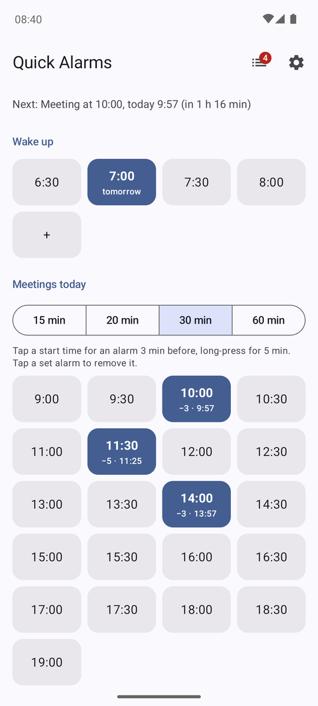
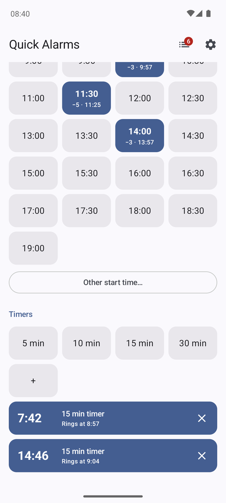
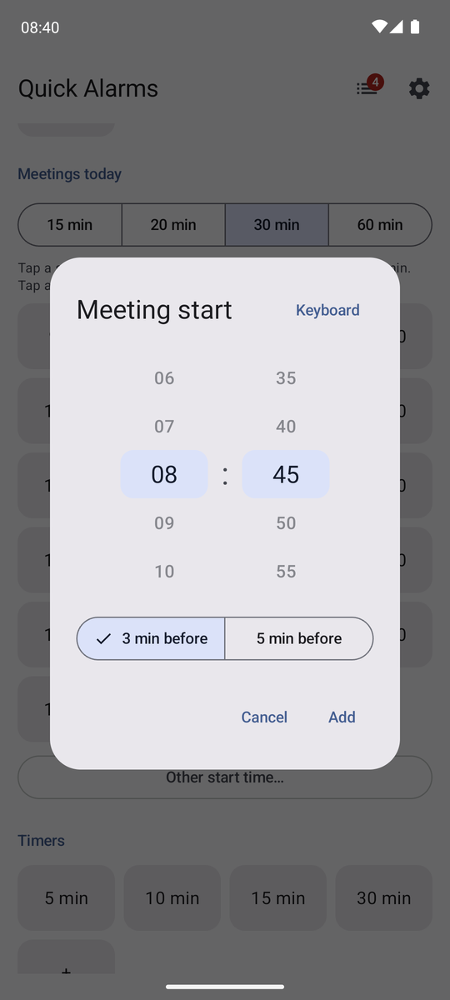
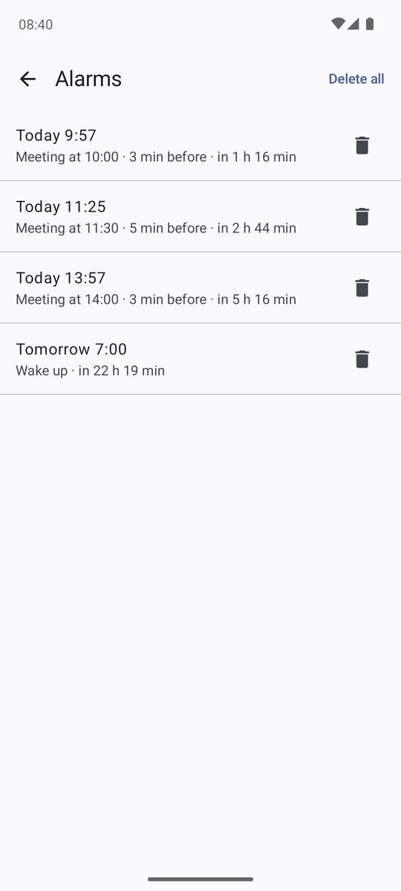
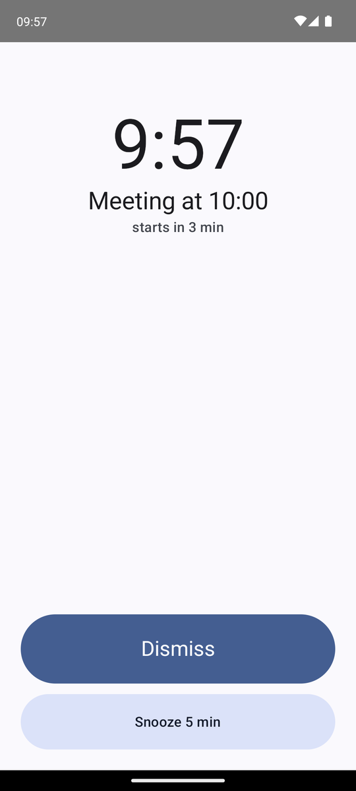

# Quick Alarms

One-tap one-time alarms and timers for an Android phone (Android 8 or newer).

<table>
  <tr>
    <td align="center"> Main screen</td>
    <td align="center"> Timers</td>
    <td align="center"> Other start time</td>
    <td align="center"> All alarms</td>
    <td align="center"> Ringing</td>
  </tr>
</table>

- **Wake up**: tap a saved time (6:30, 7:00, …) for an alarm at its next occurrence,
  usually tomorrow morning. Tap it again to cancel. **+** adds a time, either saved as a
  slot or set once; a long press on a time removes it from the slots.
- **Meetings today**: tap a meeting start time to get an alarm 3 minutes before it;
  long-press for 5 minutes. A set alarm shows as a filled cell with its lead and ring
  time (`−3 · 9:57`); tap it to remove it, long-press to switch between 3 and 5 minutes.
  "Other start time…" covers meetings off the grid, such as 10:15; that time then stays
  in the grid for the rest of the day.
- The first line under Meetings picks the grid's interval: 15, 20, 30 or 60 minutes. The
  app opens on the interval from Settings (30 minutes at first); one picked on the main
  screen lasts until you leave the app. Times with an alarm, and those added by hand,
  show at any interval.
- **Timers**: tap a length (5, 10, 15, 30 min) to start a timer. Each tap starts another
  one, so several can run at once, also of the same length. Running timers count down
  below the lengths and in a notification; ✕ or Cancel stops one. **+** adds a length,
  either saved or started once; a long press on a length removes it.
- Time dialogs open on scroll wheels: swipe the hours and the minutes (in 5-minute steps)
  up or down, or tap a number to move it to the middle. **Keyboard** switches to typing,
  which takes any minute; **Wheel** switches back, rounding to 5 minutes.
- Every change shows a snackbar with **Undo**. The list button at the top shows all
  alarms and timers; Settings sets the grid hours and the interval the app opens with,
  the two lead times, snooze, how long an alarm rings, vibration and the sound.

Alarms and timers ring with the alarm sound over the lock screen, with Snooze and
Dismiss. They survive reboots, including one overnight before the phone is unlocked. One
rings at a time: if another one comes due meanwhile, it takes over and the first shows as
missed.

## Install

With [Obtainium](https://github.com/ImranR98/Obtainium), which also installs updates:

1. Install Obtainium on the phone and allow it to install apps when asked.
2. In Obtainium: **Add app**, enter `https://github.com/t7ko/android-quick-alarms`, tap
   **Add**, then **Install**. No token is needed; the repository is public.
3. Open Quick Alarms and tap **Allow** on any red card. It needs notifications, exact
   alarms and full-screen alarms, and the alarm volume must not be muted.

Without Obtainium, download `quick-alarms-<version>.apk` from the
[Releases](https://github.com/t7ko/android-quick-alarms/releases) page and open it.

Do not force-stop the app: Android then forgets its alarms until the app is opened
again.

### Xiaomi, Redmi and POCO phones

MIUI and HyperOS add restrictions that apps cannot check, so on these phones the app
shows a blue card until you tap **Done** (Settings can show it again):

- **App info → Autostart: on.** Otherwise the phone does not tell the app it restarted,
  and alarms are lost after a restart until you open the app.
- **App info → Battery saver: No restrictions.**
- **Permissions → Show on lock screen** and **Display pop-up windows while running in
  the background: allow.** Otherwise the alarm screen may not appear.

## Development

See `AGENTS.md`. Unit tests: `gradlew.bat testDebugUnitTest`. A new version: raise
`versionCode` and `versionName` in `app/build.gradle.kts`, commit, then
`powershell -ExecutionPolicy Bypass -File scripts/release.ps1` builds the signed APK and
publishes it as a GitHub release, where Obtainium finds it.
